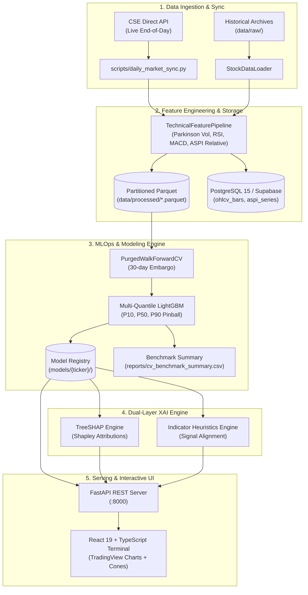

# Colombo Stock Exchange (CSE) Quantitative Intelligence Platform 📈🏛️

[](https://github.com/madushanka-ti/cse-market-intelligence/actions/workflows/ci.yml)
[](https://github.com/madushanka-ti/cse-market-intelligence/actions/workflows/daily_schedule.yml)
[](https://www.python.org/)
[](https://fastapi.tiangolo.com/)
[](https://react.dev/)
[](https://www.typescriptlang.org/)
[](https://lightgbm.readthedocs.io/)
[](https://shap.readthedocs.io/)
[](https://www.postgresql.org/)
[](https://www.docker.com/)
[](https://opensource.org/licenses/MIT)

An institutional-grade, end-to-end quantitative financial analytics and MLOps platform engineered specifically for the **Colombo Stock Exchange (CSE)**. The system processes equities price-volume dynamics and official ASPI benchmark movements to generate **30-trading-day ahead multi-quantile forecast trajectories ($P_{10}, P_{50}, P_{90}$)** under strict **Purged & Embargoed Walk-Forward Cross-Validation**, paired with mathematical **TreeSHAP** attribution and dual-layer indicator heuristic validation.

---

## 🌟 The Financial ML Problem & Architectural Philosophy

### Why Predicting Nominal Raw Prices Fails (Anti-Pattern)
In classical machine learning demos, models are frequently trained to predict raw tomorrow price $P_{t+1}$ using today price $P_t$. Because financial price series exhibit high persistence ($I(1)$ unit root processes), minimizing MSE produces trivial "identity delay" estimators ($\hat{P}_{t+1} \approx P_t$), which look accurate on paper ($R^2 > 0.98$) but generate zero actionable economic alpha.

### The Quantitative Formulation
This platform resolves the persistence trap by framing the learning problem around **cumulative forward log returns over a fixed 30-trading-day investment horizon**:

$$y_t = \ln\left(\frac{P_{t+30}}{P_t}\right)$$

- **Stationarity & Ergodicity**: Transforming prices to log returns induces covariance stationarity, allowing gradient boosting trees to discover non-linear cyclical and momentum patterns.
- **Asymmetric Multi-Quantile Pinball Optimization**: Rather than conditional mean forecasting, the platform trains three distinct LightGBM estimators minimizing pinball loss across the return distribution:
  $$\mathcal{L}_q(y, \hat{y}) = \max\left(q(y - \hat{y}), (1 - q)(\hat{y} - y)\right)$$
  - **$P_{10}$ (Quantile $\alpha=0.10$)**: Downside Value-at-Risk / stress support boundary.
  - **$P_{50}$ (Quantile $\alpha=0.50$)**: Median expected market trajectory.
  - **$P_{90}$ (Quantile $\alpha=0.90$)**: Bullish expansion resistance boundary.
- **Trajectory Mapping**: Trajectory coordinates across the 30-day forward cone are mapped as:
  $$P_{t+h, q} = P_t \times \exp\left(r_q \times \frac{h}{30}\right), \quad h \in [1, 30]$$

---

## 🛡️ Leakage-Free Purged & Embargoed Walk-Forward Cross-Validation

Standard $K$-Fold cross-validation destroys the temporal structure of financial time series and produces catastrophic lookahead bias. When training on a 30-day forward return target $y_t = \ln(P_{t+30}/P_t)$, any training observation within 30 days of the test window shares overlapping market realization data.

```
Time ───────────────────────────────────────────────────────────────────────────►
Fold 1: [████████ Train ████████] [Purge: 30d] [Test: 60d] [Embargo: 30d]
Fold 2: [████████████ Train ████████████] [Purge: 30d] [Test: 60d] [Embargo: 30d]
Fold 3: [████████████████ Train ████████████████] [Purge: 30d] [Test: 60d] ...
```

Our custom `PurgedWalkForwardCV` engine guarantees zero leakage by enforcing:
1. **Expanding Historical Training Windows**: Ensuring only past information informs future folds.
2. **Purging Overlapping Labels**: Stripping training observations whose forward 30-day return window extends into the out-of-sample evaluation split.
3. **Embargo Buffers (30 trading days)**: Preventing post-test auto-correlation leakage into subsequent folds.

---

## 🔍 Dual-Layer Explainable AI (XAI)

High-stakes capital allocation requires full transparency into model decision-making. The platform implements a two-tier explainability architecture:

1. **Layer 1: Mathematical TreeSHAP Attributions (Lundberg et al.)**
   - Exact Shapley values calculated over tree ensemble paths to isolate individual feature contributions in return space:
     $$\hat{f}(x) = \phi_0 + \sum_{i=1}^{M} \phi_i(x)$$
   - Quantifies top positive drivers (e.g. Parkinson Volatility expansion, ASPI relative strength) and top negative drivers (e.g. RSI momentum exhaustion, volume contraction).
2. **Layer 2: Domain Heuristics Alignment Engine**
   - Bridges quantitative mathematics and institutional fundamental analysis.
   - Cross-verifies model predictions against RSI-14, MACD histogram divergence, 20/50 SMA golden/death crosses, volume surge ratios, and Bollinger Band deviations to generate **Supporting**, **Rejecting / Risk Alert**, or **Neutral** signal cards.

---

## 🏗️ End-to-End System Architecture



---

## 📂 Repository Directory Layout

```text
cse-market-intelligence/
├── .github/
│   └── workflows/
│       ├── daily_schedule.yml      # Post-market automated ingestion, retraining & forecasting
│       ├── daily_ingest.yml        # EOD CSE ASPI and equities synchronization
│       └── ci.yml                  # Automated pytest execution & linting on push/PR
├── configs/
│   ├── model_config.yaml           # Quantile hyperparameters [0.10, 0.50, 0.90] & training config
│   └── tickers.yaml                # Universe of 26 target CSE blue-chip equities & sector taxonomy
├── data/
│   ├── raw/                        # Primary historical raw archives and seed datasets
│   └── processed/                  # Partitioned, zero-copy Parquet datasets (26 equities + ASPI)
├── src/
│   ├── ingestion/                  # CSE official API client, scraper & daily sync service
│   ├── features/                   # Leak-free technical indicator pipelines & ASPI alignment
│   ├── modeling/                   # Purged walk-forward CV, Multi-Quantile LightGBM & baselines
│   ├── explainability/             # TreeSHAP service & institutional heuristic validation engine
│   └── database/                   # SQLAlchemy models, session pool & PostgreSQL migrations
├── api/
│   ├── main.py                     # FastAPI application entrypoint with CORS & health probes
│   └── routes/                     # Modular API routers (/stocks, /predict, /benchmarks)
├── frontend-react/                 # React 19 + TypeScript + Tailwind + TradingView Terminal
│   ├── src/                        # Pages (Terminal, Benchmarks, Overview), components & charts
│   ├── Dockerfile                  # Container definition for frontend
│   └── vercel.json                 # Single-page application rewrites for Vercel edge deployment
├── models/                         # Serialized production LightGBM model artifacts & metrics
├── reports/                        # Purged walk-forward benchmark tournament summaries
├── scripts/                        # Operational CLI tools, historical backfill & training scripts
├── tests/                          # Automated unit and integration test suite (pytest)
├── docs/                           # Architecture specifications, data dictionary & study guides
├── .env.example                    # Sanitized environment configuration template
├── .gitignore                      # Production-grade git exclusion rules
├── Dockerfile.api                  # Container build for FastAPI serving engine
├── Dockerfile.react                # Multi-stage container build for React frontend (Nginx)
├── docker-compose.yml              # Local multi-service orchestration (Postgres + API + UI)
├── requirements.txt                # Pinned production Python dependencies
├── LICENSE                         # MIT Open-Source License
└── README.md                       # Comprehensive platform documentation
```

---

## ⚡ Quickstart & Local Setup

### Prerequisites
- **Python**: 3.11+
- **Node.js**: 20+ (with `npm`)
- **Docker & Docker Compose** (optional, for containerized run)

---

### Option A: 1-Click Multi-Service Docker Compose (Recommended)
Launch the complete stack (Postgres Database, FastAPI backend, and React Terminal):

```bash
# 1. Clone repository
git clone https://github.com/madushanka-ti/cse-market-intelligence.git
cd cse-market-intelligence

# 2. Build and launch all services in detached mode
docker compose up --build -d

# 3. Verify services
docker compose ps
```

| Service | Access URL | Description |
| :--- | :--- | :--- |
| **Trading Terminal UI** | `http://localhost:3000` | React + TradingView Financial Terminal |
| **FastAPI REST Server** | `http://localhost:8000` | REST API Backend |
| **Swagger Interactive Docs** | `http://localhost:8000/docs` | Interactive OpenAPI documentation |
| **PostgreSQL Database** | `localhost:5432` | Relational timeseries store |

---

### Option B: Local Manual Setup

#### 1. Backend & API Service
```bash
# Create and activate virtual environment
python -m venv .venv
source .venv/bin/activate  # On Windows: .venv\Scripts\activate

# Install dependencies
pip install --upgrade pip
pip install -r requirements.txt

# Copy environment configuration
cp .env.example .env

# Start FastAPI serving server
uvicorn api.main:app --host 0.0.0.0 --port 8000 --reload
```

#### 2. React Financial Terminal
```bash
cd frontend-react
npm install
npm run dev
```
Open **`http://localhost:5173`** in your browser.

---

## 🧪 Automated Testing & Verification

Run the comprehensive pytest suite verifying features, leakage-free alignment, API contracts, and TreeSHAP additivity:

```bash
# Run all automated tests
pytest -v

# Run targeted test suites
pytest -v tests/test_features.py
pytest -v tests/test_api.py
pytest -v tests/test_explainability.py
pytest -v tests/test_modeling.py
```

---

## 🔄 Daily Automated MLOps Pipeline

The platform is designed to operate autonomously without manual intervention:
1. **Daily Market Close Sync**: Configured in `.github/workflows/daily_schedule.yml` to trigger at **15:00 Colombo Time (09:30 UTC)** post-market close.
2. **Ingestion & Validation**: Scrapes official CSE closing prices, runs circuit breaker checks, and appends to partitioned Parquet files.
3. **Model Refresh**: Fits expanding-window multi-quantile LightGBM models and updates TreeSHAP baselines.
4. **Artifact Upload**: Deploys updated weights and cross-validation summaries directly to production serving storage.

---

## 📄 License
This project is licensed under the terms of the [MIT License](LICENSE).
