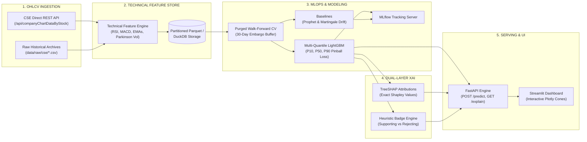

# Colombo Stock Exchange (CSE) 30-Day Return Forecasting Platform 📈🏛️

[](https://www.python.org/)
[](https://lightgbm.readthedocs.io/)
[](https://duckdb.org/)
[](https://shap.readthedocs.io/)
[](https://mlflow.org/)
[](https://fastapi.tiangolo.com/)
[](https://streamlit.io/)
[](https://www.docker.com/)

A production-grade, institutional-quality MLOps platform engineered for the **Colombo Stock Exchange (CSE)**. The system relies **strictly on historical equities price and volume (OHLCV) time-series data** to generate **30-trading-day ahead multi-quantile return forecasts ($P_{10}, P_{50}, P_{90}$)** validated under strict **Purged & Embargoed Walk-Forward Cross-Validation**.

---

## 🌟 Core Premise & Value Proposition

- **Pure Historical OHLCV Dynamics**:
  The forecasting pipeline is deliberately decoupled from volatile macroeconomic announcements, Google Trends, and third-party sentiment feeds. Modeling relies **exclusively on clean equities market action**: `Open`, `High`, `Low`, `Close`, `Volume`, and their derived mathematical dynamics (Parkinson Volatility, RSI, MACD, EMAs/SMAs, and Bollinger Bands).
- **30-Day Ahead Multi-Quantile Cones ($P_{10}, P_{50}, P_{90}$)**:
  Rather than predicting raw nominal prices (which causes trivial lag-following identity models), the system optimizes asymmetric **Pinball Loss** on cumulative 30-day forward log returns:
  $$y_t = \ln\left(\frac{P_{t+30}}{P_t}\right)$$
  - **$P_{10}$**: Downside risk boundary (10th percentile).
  - **$P_{50}$**: Median expected trajectory.
  - **$P_{90}$**: Bullish growth boundary (90th percentile).
- **Leak-Free Purged & Embargoed Walk-Forward CV**:
  Because forward cumulative targets span 30 trading days, standard $K$-Fold cross-validation suffers from catastrophic label leakage. Our custom validation engine purges overlapping forward training labels and enforces a **30-trading-day embargo buffer**.
- **Dual-Layer Technical Explainability (XAI)**:
  1. *Mathematical Layer*: Exact **TreeSHAP** (Lundberg et al.) Shapley attributions decomposing each price/volume feature's contribution in return space.
  2. *Retail Investor Heuristics*: Rule engine translating technical indicators (RSI overbought/oversold, 20-day SMA trend, MACD histogram, Parkinson volatility, and Bollinger Bands) into intuitive **"Supporting"** vs. **"Rejecting"** decision badges.

---

## 🏗️ End-to-End System Architecture



---

## 📊 Technology Stack

| Domain | Technology | Purpose |
| :--- | :--- | :--- |
| **Language & Runtime** | Python 3.11 | High-performance type-hinted runtime |
| **Data Engine & Storage** | DuckDB, Apache Parquet, PyArrow, Pandas | Columnar, zero-copy analytics and partitioned caching |
| **Machine Learning** | LightGBM, Scikit-Learn | Multi-quantile gradient boosting minimizing Pinball loss |
| **Time-Series Baselines** | FB Prophet, Random Walk with Drift | Structural trend decomposition and benchmark tournament |
| **Cross-Validation** | Custom `PurgedWalkForwardCV` | Leakage-free time-series splitting with embargo gap |
| **Explainable AI (XAI)** | TreeSHAP (`shap`), Rule Engine | Exact Shapley attributions + heuristic badge alignment |
| **Experiment Tracking** | MLflow | Metric logging, parameters, coverage, and model artifacts |
| **Serving API** | FastAPI, Uvicorn, Pydantic v2 | High-throughput async REST API |
| **Interactive Dashboard**| Streamlit, Plotly | Interactive forecast cones, SHAP waterfalls, and badge cards |
| **Deployment** | Docker, Docker Compose | Production-grade containerization |

---

## 📂 Project Directory Structure

```text
cse-market-intelligence/
├── configs/
│   ├── model_config.yaml          # Quantiles [0.1, 0.5, 0.9], lag windows, and hyperparameters
│   └── tickers.yaml               # Target CSE tickers (JKH.N0000, COMB.N0000, etc.)
├── data/
│   ├── raw/                       # Preserved historical stock CSVs (2021-2025 OHLCV)
│   │   ├── cse/                   # 26 Blue-chip daily OHLCV files
│   │   └── yearly/                # 2021.csv - 2025.csv annual transaction archives
│   └── processed/                 # Partitioned Parquet feature datasets (.gitkeep preserved)
├── src/
│   ├── __init__.py
│   ├── ingestion/
│   │   ├── cse_scraper.py         # Session HTTP client querying official CSE API endpoints
│   │   └── data_loader.py         # Standardizes column schemas & Parquet storage
│   ├── features/
│   │   └── technical_features.py  # Vectorized RSI, MACD, EMAs, Parkinson Volatility, target y_t
│   ├── modeling/
│   │   ├── walk_forward_cv.py     # Purged & embargoed walk-forward time-series CV engine
│   │   ├── baseline_prophet.py    # FB Prophet baseline / trend decomposition benchmark
│   │   ├── train_lightgbm.py      # Multi-quantile LightGBM training + MLflow tracking
│   │   └── predict.py             # Inference pipeline generating 30-day forecast cones
│   └── explainability/
│       ├── shap_service.py        # TreeSHAP technical feature attributions for 30-day predictions
│       └── heuristics_engine.py   # Rule engine mapping technical indicators to "Supporting" vs "Rejecting"
├── api/
│   ├── main.py                    # FastAPI server entrypoint
│   └── routes/
│       ├── predict.py             # POST /api/v1/predict/{symbol}
│       └── explain.py             # GET /api/v1/explain/{symbol}
├── frontend/
│   └── app.py                     # Interactive Streamlit dashboard with Plotly forecast cones
├── notebooks/
│   └── 01_eda_and_cv_validation.ipynb # End-to-end interactive Walk-Forward & XAI workflow
├── docs/
│   ├── architecture.md            # Modern pipeline & MLOps system architecture
│   ├── data_dictionary.md         # Schema of raw OHLCV and engineered technical features
│   └── modeling_strategy.md       # Target formulation, Purged CV rationale, and XAI theory
├── tests/
│   ├── test_features.py           # Unit tests for indicator calculations & Parkinson volatility
│   └── test_ingestion.py          # Unit tests for scraper parsing and data loading
├── .gitignore                     # Production-grade Git exclusions
├── Dockerfile                     # Optimized Python 3.11 container definition
├── docker-compose.yml             # Orchestration for FastAPI + Streamlit
├── requirements.txt               # Pinned core production dependencies
└── README.md
```

---

## ⚡ Quickstart & Local Setup

### 1. Prerequisites & Environment Setup
Clone the repository and set up a virtual environment:

```bash
# Using uv (Recommended for speed)
uv venv --python 3.11
.venv\Scripts\activate          # Windows PowerShell: .venv\Scripts\Activate.ps1
uv pip install -r requirements.txt

# Or using standard python
python -m venv .venv
source .venv/bin/activate        # Linux/macOS
pip install -r requirements.txt
```

### 2. Run Test Suite
Validate technical feature calculation, Parkinson volatility, and data ingestion:

```bash
pytest tests/ -v
```

### 3. Launch FastAPI Serving Layer
Start the async REST API:

```bash
uvicorn api.main:app --host 0.0.0.0 --port 8000 --reload
```
- Swagger UI Documentation: [http://localhost:8000/docs](http://localhost:8000/docs)
- Interactive OpenAPI Spec: [http://localhost:8000/openapi.json](http://localhost:8000/openapi.json)

#### Example API Request:
```bash
# 30-Day Forecast Cone for John Keells Holdings (OHLCV-derived)
curl -X POST "http://localhost:8000/api/v1/predict/JKH.N0000" \
     -H "Content-Type: application/json" \
     -d '{"horizon_days": 30}'

# Dual-Layer Explainability (TreeSHAP + Heuristic Badges)
curl -X GET "http://localhost:8000/api/v1/explain/JKH.N0000"
```

### 4. Launch Interactive Streamlit Dashboard
Launch the graphical interface:

```bash
streamlit run frontend/app.py --server.port 8501
```
Explore interactive 30-day forecast cones, TreeSHAP impact bars, and technical heuristic badges.

### 5. Run via Docker Compose
To run both the backend API and frontend dashboard in containers:

```bash
docker-compose up --build
```

---

## 🔬 Scientific Highlights & Defense

1. **Why Strictly Historical Stock Data (OHLCV)?**
   Macroeconomic series (e.g., quarterly GDP, monthly inflation) are released with significant publication lag (30 to 90 days), creating severe cross-frequency alignment pitfalls, revision risks, and lookahead vulnerability. Relying strictly on high-frequency equities market dynamics guarantees 100% point-in-time authenticity, zero external scraping failure points, and robust intraday/daily reproducibility.
2. **Why Predict Quantiles ($P_{10}, P_{50}, P_{90}$)?**
   Emerging markets like the CSE exhibit non-Gaussian fat-tailed distributions and structural volatility regimes. A single point estimate provides zero confidence context. Quantile regression bounds the distribution into an actionable 80% uncertainty envelope.
3. **Purged Walk-Forward CV Realism**:
   Multi-step forward returns ($y_t = \ln(P_{t+30}/P_t)$) create overlapping dependency windows. Purged Walk-Forward Cross-Validation discards overlapping training windows and adds an embargo gap, guaranteeing 100% leak-free out-of-sample evaluation.

---

## 📄 License & Attribution
Designed for quantitative financial research on the Colombo Stock Exchange. Open-source under the MIT License.
