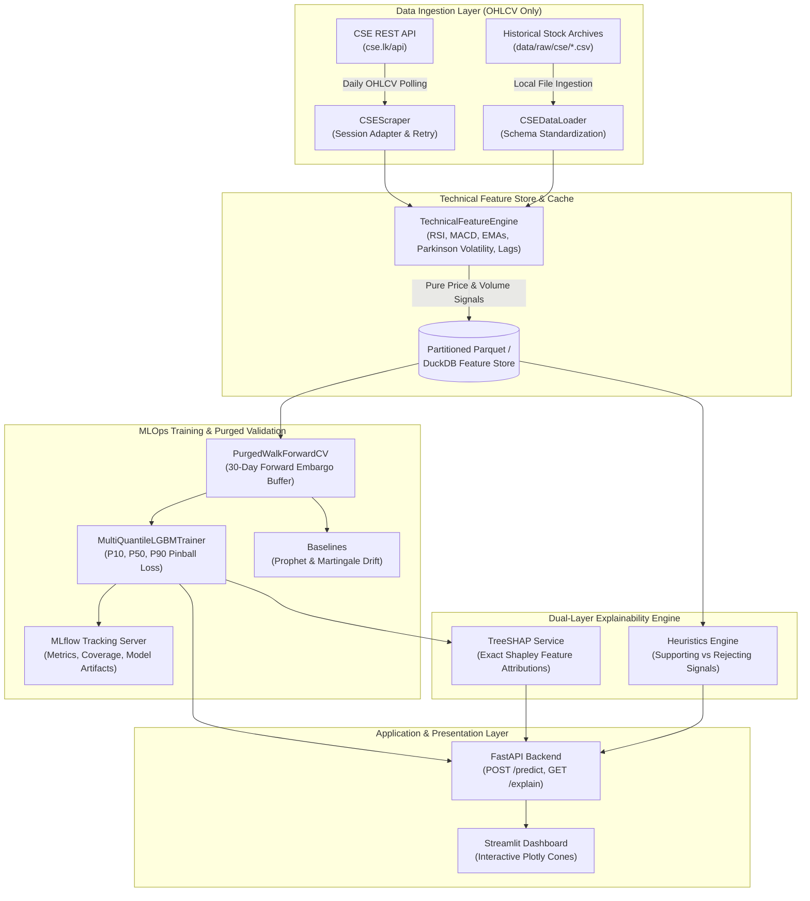

# CSE Market Intelligence Platform: Production MLOps Architecture (OHLCV Only)

The **Colombo Stock Exchange (CSE) Market Intelligence Platform** follows a decoupled, production-grade MLOps architecture designed for high scalability, leak-free time-series processing, and institutional-grade explainability strictly modeled on historical equities price and volume (OHLCV) dynamics.

---

## 1. High-Level Architecture Diagram

---

## 2. Core Architectural Pillars

### Pillar 1: Pure Historical Equities Ingestion
- **Direct CSE Portal Client (`src/ingestion/cse_scraper.py`)**: Queries `https://www.cse.lk/api/companyInfoSummery` to resolve security symbol IDs and fetches daily candlestick bars from `/companyChartDataByStock` with automatic connection pooling and exponential backoff retry.
- **Storage Abstraction & Standardization (`src/ingestion/data_loader.py`)**: Loads multi-year stock archives (`data/raw/yearly/`) and individual equity CSVs (`data/raw/cse/`), standardizes them to `['date', 'symbol', 'open', 'high', 'low', 'close', 'volume']`, and caches processed matrices into high-performance Parquet format (`data/processed/`).

### Pillar 2: Technical Feature Engineering (Strictly OHLCV)
All predictive signals are strictly computed from historical equities dynamics, avoiding unreliable external data:
1. **Autoregressive Returns**: 1-day logarithmic returns, high-low percentage range, and intraday displacement.
2. **Trend & Moving Averages**: Exponential Moving Averages (10, 20, 50, 200) and normalized price distances ($\text{dist\_ema}$).
3. **Momentum Oscillators**: Wilder's RSI (14) and MACD (12, 26, 9) with momentum histogram.
4. **Volatility Estimators**: Annualized Parkinson High-Low volatility ($N=20$) and Bollinger Bands (%B and Band Width).
5. **Autoregressive Lags**: Multi-step return lags ($t-1, t-2, t-3, t-5, t-10$).

### Pillar 3: Purged & Embargoed Walk-Forward Cross-Validation
Because multi-step returns ($y_t = \ln(P_{t+30}/P_t)$) create overlapping dependency windows, standard $K$-Fold cross-validation leaks future information into earlier folds.
- **Purging**: Training points within 30 trading days prior to the evaluation window are strictly removed.
- **Embargoing**: An explicit 30-trading-day buffer separates training and test splits to neutralize serial autocorrelation spillover.

### Pillar 4: Multi-Quantile Uncertainty Estimation
Emerging market equities exhibit non-Gaussian returns with fat tails. Rather than predicting an overconfident single number, the platform trains three distinct LightGBM regressors minimizing the **Pinball Loss**:
$$\mathcal{L}_\alpha(y, \hat{y}) = \max(\alpha(y - \hat{y}), (\alpha - 1)(y - \hat{y}))$$
for quantiles $\alpha \in \{0.10, 0.50, 0.90\}$, constructing an 80% confidence forecast cone $[P_{10}, P_{90}]$ around the median path $P_{50}$.

### Pillar 5: Dual-Layer Explainability (XAI)
1. **Mathematical Attribution (TreeSHAP)**:
   Exact Shapley values decomposing marginal price and volume indicator impacts in return space.
2. **Retail Investor Technical Badges**:
   Rule engine translating technical indicators (RSI overbought/oversold, 20-day SMA trend, MACD momentum, Bollinger Band touch, and Parkinson volatility) into color-coded **"Supporting"** vs. **"Rejecting"** badges.

---

## 3. Serving & Containerization

- **FastAPI Backend (`api/main.py`)**:
  - `POST /api/v1/predict/{symbol}`: Returns 30-day forecast cone ($P_{10}, P_{50}, P_{90}$) and daily trajectory points.
  - `GET /api/v1/explain/{symbol}`: Returns TreeSHAP feature drivers and rule-based heuristic badges.
  - `GET /health`: Liveness and readiness health probe.
- **Interactive Dashboard (`frontend/app.py`)**:
  - Streamlit dashboard with interactive Plotly forecast cones, TreeSHAP impact bars, and heuristic badge cards.
- **Docker Compose (`docker-compose.yml`)**:
  - Unified orchestration launching the FastAPI engine on port `8000` and the Streamlit dashboard on port `8501`.
