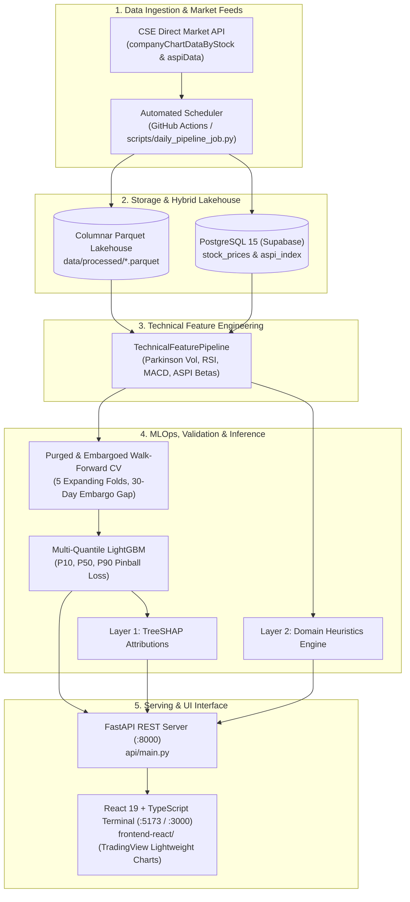

# Architecture & System Design Specification

## 1. Executive Summary

The **Colombo Stock Exchange (CSE) Market Intelligence Platform** is a production-grade, institutional-quality quantitative analytics and MLOps engine. It is architected specifically to analyze frontier equity markets by ingesting historical price-volume data from the Colombo Stock Exchange (CSE), computing statistical and technical signal dynamics relative to the official All Share Price Index (ASPI), and training multi-quantile gradient-boosted decision trees to forecast **30-trading-day forward cumulative return distributions**.

The platform is designed around strict quantitative time-series principles:
- **Zero Macro Leakage / Decoupled Data Scope**: The platform operates purely on official CSE historical equities feeds (26 listed tickers) and the official ASPI index.
- **Stationarity over Persistence**: Avoiding nominal price forecasting in favor of forward log returns.
- **Leak-Free Model Evaluation**: Purged and 30-day embargoed walk-forward cross-validation.
- **Dual-Layer Explainability**: Mathematical local attribution (TreeSHAP) coupled with domain-specific rule-based heuristics.
- **Tiered Hybrid Storage**: In-memory columnar Parquet/DuckDB for low-latency serving paired with managed PostgreSQL (Supabase) for long-term historical records and audit tracking.

---

## 2. End-to-End System Topology



---

## 3. Component Architecture & Directory Decoupling

The repository is structured strictly around clean separation of concerns:

```text
cse-market-intelligence/
├── configs/
│   ├── model_config.yaml           # Quantile thresholds, lag windows & hyperparameters
│   └── tickers.yaml                # Universe of 26 target CSE blue-chip equities
├── data/
│   ├── raw/                        # Primary raw archives and SQL seed backups
│   └── processed/                  # Partitioned Parquet datasets (26 equities + ASPI)
├── src/
│   ├── ingestion/                  # CSE API scrapers, parsers & daily sync services
│   ├── features/                   # Technical indicator math & ASPI benchmark relative returns
│   ├── modeling/                   # Purged walk-forward CV, multi-quantile LightGBM & baselines
│   ├── explainability/             # TreeSHAP service & institutional heuristic validation engine
│   └── database/                   # SQLAlchemy ORM models, session pooling & migration tooling
├── api/
│   ├── main.py                     # FastAPI application factory, CORS & health probes
│   └── routes/                     # Modular API routers (/stocks, /predict, /benchmarks)
├── frontend-react/                 # React 19 + TypeScript + Tailwind + TradingView terminal
├── models/                         # Serialized production LightGBM model weights (lgb_p*.txt)
├── reports/                        # Model benchmark comparisons & CV tournament summaries
├── scripts/                        # Production orchestration, historical backfill & training CLI
└── tests/                          # 29-test automated pytest suite
```

---

## 4. Key Architectural Trade-Offs & Decisions

| Decision | Selected Option | Considered Alternative | Rationale |
| :--- | :--- | :--- | :--- |
| **Target Variable** | 30-Day Forward Log Return $y_t = \ln(P_{t+30}/P_t)$ | Nominal Future Price $P_{t+30}$ | Nominal prices exhibit non-stationary random walk behavior, resulting in models that learn identity persistence ($P_{t+30} \approx P_t$) with zero economic value. |
| **Validation Scheme** | Purged Walk-Forward CV with 30-day embargo | Standard $K$-Fold or TimeSeriesSplit | Standard CV leaks future forward returns across overlapping 30-day windows. The embargo ensures complete independence between training and test sets. |
| **Model Class** | Multi-Quantile LightGBM ($P_{10}, P_{50}, P_{90}$) | Deep Learning (LSTM/Transformer) | Frontier equity series contain tabular features with limited daily sample size (~1,000–2,000 rows). Tree-based quantile regression converges robustly without overfitting. |
| **Serving Storage** | Columnar Apache Parquet | Direct SQL query per request | Parquet provides sub-millisecond columnar zero-copy scans, allowing instant forecast inference even when database connections sleep or experience latency. |
| **Database** | PostgreSQL with Composite Primary Keys | NoSQL (MongoDB / DynamoDB) | Financial market series require strict data integrity guarantees: composite key `(symbol, date)` prevents duplicate bars, while indexed point-in-time queries remain fast. |

---

## 5. Security & Production Deployment Profile

1. **Zero Secret Leakage**:
   - Environment variables are isolated via `.env.example`.
   - Production connection strings are passed exclusively through cloud secret managers (Render Web Service Environment and GitHub Actions Secrets).
2. **Containerization**:
   - `Dockerfile`: Multi-stage, low-footprint container using `python:3.11-slim` with `libgomp1` OpenMP multiprocessing support.
   - Dynamic port binding via `${PORT:-8000}` compatible with serverless containers (Render, Google Cloud Run, AWS App Runner).
3. **Resilient Frontend Offline / Cold-Start Support**:
   - High-fidelity pre-computed snapshots for all 26 equities are bundled in `frontend-react/src/data/fallbackData.ts`. If cloud backend containers undergo idle sleep, the user experiences zero broken screens or failed promises.
