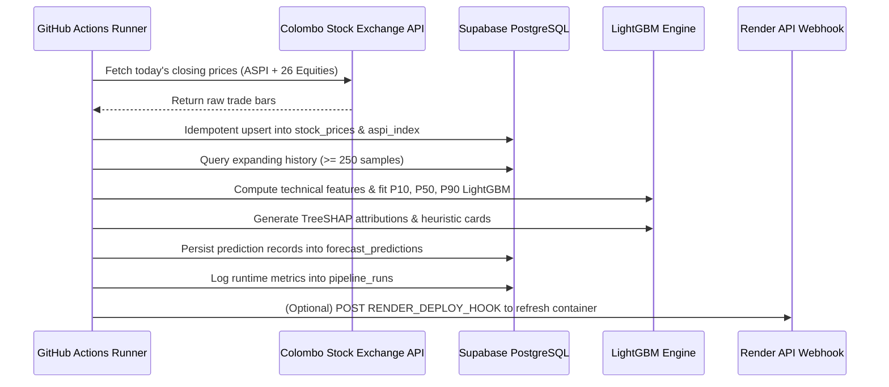

# Production Deployment & MLOps Operations Guide

## 1. Cloud Infrastructure Overview (100% Free Tier Architecture)

The platform is designed to run indefinitely on resilient, zero-cost cloud tiers:

| Tier | Component | Cloud Provider | Free Tier Specification |
| :--- | :--- | :--- | :--- |
| **Frontend UI** | React 19 + TradingView Terminal | **Vercel** | Global CDN Edge, unlimited deployments & custom domains. |
| **Backend API** | FastAPI + LightGBM MLOps Engine | **Render** | 512 MB RAM Docker Web Service with automatic SSL. |
| **Database** | PostgreSQL 15 | **Supabase** | 500 MB relational database with Connection Pooler. |
| **Automation** | Daily Market Close Retraining Cron | **GitHub Actions**| 2,000 minutes/month free Ubuntu runners. |

---

## 2. Deploying the Backend API (Render)

1. **Repository Settings**: Push code to GitHub.
2. In **[dashboard.render.com](https://dashboard.render.com)**:
   - Click **New +** $\to$ **Web Service**.
   - Select your `cse-market-intelligence` repository.
   - **Runtime**: `Docker`
   - **Region**: `Frankfurt` (matches Supabase EU Central)
   - **Instance Type**: `Free`
3. **Environment Variables**:
   - `DATABASE_URL`: Your Supabase connection string.
   - `PORT`: `8000`
4. Deploy the service. Once built, note your public URL:
   `https://<your-service-name>.onrender.com`

---

## 3. Deploying the React Terminal (Vercel)

1. In **[vercel.com](https://vercel.com)**:
   - Click **Add New...** $\to$ **Project**.
   - Select the repository.
   - **Framework Preset**: `Vite`
   - **Root Directory**: `frontend-react`
   - **Build Command**: `npm run build`
   - **Output Directory**: `dist`
2. **Environment Variables**:
   - `VITE_API_URL`: Your Render backend URL (e.g. `https://cse-market-intelligence.onrender.com`).
3. Deploy. The platform is configured with `vercel.json` for single-page application routing.

---

## 4. Automated Daily Post-Market MLOps Pipeline

The automated workflow in `.github/workflows/daily_schedule.yml` runs every weekday at **15:00 Colombo time (09:30 UTC)**:



---

## 5. Local Docker Compose Multi-Service Deployment

To spin up the entire isolated stack locally (Postgres + FastAPI + React UI):

```bash
# Build and run containers
docker compose up --build -d

# View status
docker compose ps

# Tail logs
docker compose logs -f api
```

- **React Terminal**: `http://localhost:3000`
- **FastAPI Backend**: `http://localhost:8000`
- **Interactive Swagger Docs**: `http://localhost:8000/docs`
- **Postgres Database**: `localhost:5432`

---

## 6. MLOps Monitoring & Model Diagnostics

1. **Quantile Calibration Tracking**:
   Models are evaluated via Pinball Loss and 80% coverage ($P_{10} \le y \le P_{90}$). Coverage is logged per fold and must remain within $[75\%, 85\%]$.
2. **Data Drift Detection**:
   `scripts/daily_market_sync.py` checks for price anomalies exceeding circuit-breaker thresholds ($\pm 25\%$ daily jump) before committing to storage.
3. **Execution Telemetry**:
   Each run records total duration, symbol count, and errors in the `pipeline_runs` table:
   ```sql
   SELECT execution_date, pipeline_type, status, duration_seconds, error_count 
   FROM pipeline_runs 
   ORDER BY created_at DESC 
   LIMIT 10;
   ```
